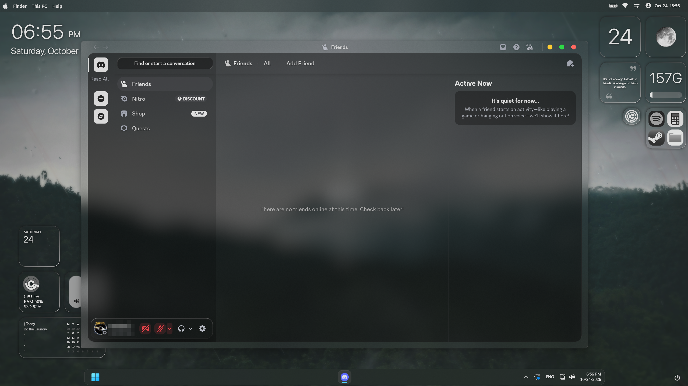

# Clearframe

**Based on [Translucence by CapnKitten](https://github.com/CapnKitten/Translucence), the original theme creator.** Clearframe is an unofficial customization of Translucence. CapnKitten does not endorse this project.

Clearframe features clear desktop-visible transparency when supported by your Discord client setup, plus macOS-style red close, yellow minimize, and green maximize/restore window buttons. It also includes readable settings, neutral black and charcoal styling without a blue or purple tint, and rounded panels.

## Install

- **Vencord:** Put `Clearframe.theme.css` in Vencord's themes folder and enable it under **User Settings → Themes**. You can also paste its contents into **QuickCSS**.
- **BetterDiscord:** Put `Clearframe.theme.css` in the BetterDiscord themes folder and enable it under **User Settings → Themes**.

## Transparency setup

In Vencord, enable **Enable Window Transparency** in **User Settings → Vencord**, then restart Discord. This is required for desktop-visible transparency; CSS alone cannot make the native Discord window transparent.

For optional frosted-glass blur on Windows, use [Mica For Everyone](https://github.com/MicaForEveryone/MicaForEveryone). Add a rule for Discord's process and choose **Acrylic** as the backdrop type. Mica For Everyone supplies the Windows backdrop effect; Clearframe does not create native desktop blur. Acrylic support and appearance can vary with Windows and Discord versions.

For the best experience, go to **Discord Settings → Appearance** and select **Onyx** (Dark Mode).

## Credit

CapnKitten created the original [Translucence theme](https://github.com/CapnKitten/Translucence) and its upstream stylesheet, which this theme imports remotely. Clearframe's readability and visual styling are my customization.
